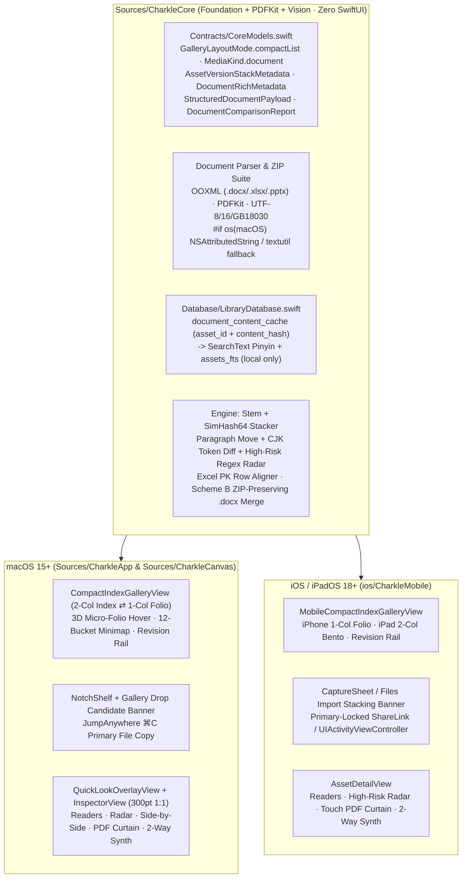

# Technical Design: Apple Dual-Platform Document Stack, Multi-Modal Diff, Scheme B 2-Way Merge & Tactile Compact View

> **Task**: `.trellis/tasks/11-28-macos-document-stack-diff-and-compact-view/`  
> **Authorities**: `AGENTS.md`, `DESIGN.md`, `.trellis/spec/cross-platform/index.md`, `.trellis/spec/macos/native-design-system.md`, `ios/README.md`

---

## 1. Module Boundaries & Dual-Platform Sharing Architecture

### Hard Platform Isolation Rules
1. **`Sources/CharkleCore` iOS Compatibility**: Zero `import SwiftUI`; guard `AppKit`, `Foundation.Process`, and `/usr/bin/textutil` strictly behind `#if os(macOS)` / `#if canImport(AppKit)` so `CharkleMobile` links `CharkleCore` directly without conditional target hacks.
2. **Copy-on-Write `AssetRichMetadata` Storage**: Extend `AssetRichMetadata` (`ImmutableMetadataBox` / `Storage`) with optional `versionStack: AssetVersionStackMetadata?` and `document: DocumentRichMetadata?` using `decodeIfPresent` so legacy `/.charkle/ops/*.jsonl` shards and un-upgraded clients round-trip losslessly.
3. **Local-Only Full-Text Cache**: `document_content_cache` lives exclusively in local SQLite (`library.sqlite`) keyed by `(asset_id, content_hash)` and feeds `assets_fts` during `put(_:)`; full extracted document body text is NEVER written into `AssetRecord` JSON payloads or `/.charkle/ops/*.jsonl` sync logs.

---

## 2. Core Data Contracts & Sync Wire Format

### 2.1 Synced `AssetRichMetadata` Extensions (`CoreModels.swift`)
- **`AssetVersionStackMetadata`**:
  - `groupID: UUID` (uppercase RFC-4122)
  - `versionNumber: Int` (`>= 1`)
  - `parentAssetID: UUID?`
  - `versionLabel: String?`
  - `editorName: String?`
  - `changeNote: String?`
  - `isPinnedPrimary: Bool`
- **`DocumentDiffSummary`**:
  - `comparedToAssetID: UUID`
  - `addedBlocks: Int`, `removedBlocks: Int`, `modifiedBlocks: Int`, `movedBlocks: Int`
  - `highRiskNumberChanges: Int`, `highRiskDateChanges: Int`
  - `minimapBuckets: [Int]` (12 segments normalized across document length: `0` = unchanged, `1` = general edit/addition, `2` = high-risk numeric/currency/date mutation)
- **`DocumentRichMetadata`**:
  - `formatFamily: String` (`"docx" | "xlsx" | "pptx" | "pdf" | "markdown" | "plainText" | "legacyOffice"`)
  - `wordCount: Int`, `pageCount: Int`, `sheetNames: [String]`
  - `hasNativeRevisions: Bool`, `hasTextLayer: Bool`
  - `diffSummary: DocumentDiffSummary?`

### 2.2 Engine Protocol Surface (`CharkleEngineProtocol`)
Provide default protocol extensions on `CharkleEngineProtocol` so `PlaceholderEngine` and test doubles compile seamlessly:
- `detectVersionStackCandidate(for fileURL: URL, targetFolderID: UUID?) async throws -> VersionStackCandidate?`
- `detectVersionStackCandidate(forAssetID: UUID) async throws -> VersionStackCandidate?`
- `manageVersionStack(_ mutation: VersionStackMutation) async throws -> [AssetRecord]`
- `readStructuredDocument(assetID: UUID) async throws -> StructuredDocumentPayload`
- `compareDocumentVersions(baseAssetID: UUID, targetAssetID: UUID, sheetName: String?, primaryKeyCol: Int?, useOCRIfScanned: Bool) async throws -> DocumentComparisonReport`
- `synthesizeDocumentVersion(baseAssetID: UUID, targetAssetID: UUID, preferTargetAsTemplate: Bool, decisions: [DocumentMergeDecision], editorName: String?, changeNote: String?) async throws -> AssetRecord`

---

## 3. Deterministic Algorithms & Safety Invariants

1. **Filename Stem Normalizer & SimHash64 Candidate Matching (`< 150ms`)**:
   - Strip copy suffixes (`(1)`, `（2）`, `的副本`, `copy`), version tokens (`_v2`, `V3.1`, `第4版`), workflow stage tags (`初稿`, `修改稿`, `审阅稿`, `核定稿`, `定稿`, `终版`, `最终版`, `净版`), leading/trailing date stamps (`20260512`, `05-12`), and trailing editor annotations (`-张主任改`, `（李科长核定）` -> extracted as `suggestedEditorName`).
   - Compute 64-bit FNV-1a + Murmur3-mixed SimHash over normalized document paragraphs (weight `3`) and 2-character shingles (weight `1`); compute angular similarity `max(0, 1.0 - hamming / 32.0)` and match candidates when canonical stem matches (`score = 0.90` / `0.92 + 0.08 * sim`) or `similarity >= 0.45` (`hamming <= 17`, `wordCount >= 12`).
2. **Multi-Modal Diff & High-Risk Radar**:
   - Exact hash anchor matching -> SimHash similarity matching for modified & moved blocks (`movedFromIndex`) -> CJK word/character inline diff tokens.
   - Deterministic regex radar flags changes in numbers, currencies (`¥`, `$`, `元`, `万元`, `亿元`), percentages (`%`, `百分点`), and dates/deadlines (`YYYY年MM月DD日`, `MM月DD日前`, `Q1–Q4`, `工作日`) as high-risk (`bucket = 2`).
   - Spreadsheet diff auto-selects high-uniqueness non-numeric key columns (or user-selected `primaryKeyCol`) to align inserted/deleted rows before cell-by-cell value and `<f>` formula comparison.
3. **Scheme B Zero-Corruption `.docx` 2-Way Synthesis**:
   - Clone template `.docx` ZIP archive preserving every non-document entry (`word/styles.xml`, `word/numbering.xml`, `word/header*.xml`, `word/footer*.xml`, `word/media/*`, `[Content_Types].xml`, `_rels/*`) byte-for-byte.
   - Only splice plain top-level `<w:body>/<w:p>` nodes mapped 1:1 by deterministic paragraph index where `!isProtectedComplex` (rejecting/locking paragraphs with `<w:fldChar w:fldCharType="begin">`, `<w:drawing>`, `<mc:AlternateContent>`, `<w:pict>`, `<o:OLEObject>`, or complex merged `<w:tbl>`).
   - Parse synthesized `word/document.xml` with `XMLParser` before writing `vN+1` to disk; abort cleanly without partial writes if XML validation fails.
