# Technical Design: Windows Parity — Document Stack, Multi-Modal Diff, Scheme B 2-Way Merge & Fluent 2 Tactile Compact View

> **Task**: `.trellis/tasks/11-28-windows-document-stack-diff-and-compact-view-parity/`  
> **Canonical Sync Blueprint**: [`docs/WINDOWS_DOCUMENT_SYNC_SPEC.md`](../../../docs/WINDOWS_DOCUMENT_SYNC_SPEC.md)  
> **Authorities**: `AGENTS.md`, `windows/AGENTS.md`, `DESIGN.md`, `.trellis/spec/cross-platform/index.md`, `.trellis/spec/windows/index.md`, `.trellis/spec/windows/fluent2-design-system.md`

---

## 1. End-to-End Windows Architecture & Layer Seams

```mermaid
flowchart TB
    subgraph WinPlatform["windows/crates/charkle-platform-win (Win32 / WinRT)"]
        IFilter["ifilter.rs\nWin32 LoadIFilter + OLE UTF-16 fallback\n(spawn_blocking + catch_unwind)"]
        WinOCR["ocr.rs\nWinRtOcrProvider (zh-Hans / en-US)"]
        WinClip["clipboard.rs & drag_out.rs\nCF_HDROP (\\\\?\\-stripped) & OLE DoDragDrop"]
        WinShelf["shelf_win.rs\nFrame-0 Hit-Rect + Own-Thread DropCatcher"]
    end

    subgraph Core["windows/crates/charkle-core (100% OS-Agnostic · Shared with Android FFI)"]
        Models["models/core.rs & models/document.rs\nAssetVersionStackMetadata · DocumentRichMetadata\nGalleryLayoutMode::CompactList · MediaKind::detect"]
        Codec["wire/swift_codec.rs\nCocoa Epoch · Uppercase UUID · SyncFields LWW"]
        DB["db/library_db.rs & search_text.rs\ndocument_content_cache (i64-cast simhash64)\n-> assets_fts + Pinyin (zero sync_ops bloat)"]
        DocEngine["media/document_parser.rs · version_stack.rs\ndocument_diff.rs · document_merge.rs · artwork.rs\nOOXML/PDF/GB18030 · Radar · PK Align · .docx 2-Way"]
    end

    subgraph TauriHost["windows/src-tauri (Thin Tauri v2 IPC + charkle-media://)"]
        Cmds["commands/documents.rs & commands/native.rs\n5 Document/Stack IPCs + Primary-Resolved Copy/Drag"]
        Proto["protocol.rs\nHTTP 206 Range /original/<uuid> for pdfjs-dist"]
    end

    subgraph ReactUI["windows/ui (React 19 · Zustand 5 · Fluent 2 · Tailwind v4)"]
        Stores["coordinatorStore.ts & libraryStore.ts\nPer-Destination Layout · groupID Primary Folding"]
        Compact["GalleryCompactView.tsx\n2-Col Bento ⇄ 1-Col Folio · 3D Micro-Folio\n12-Bucket Minimap · Inline Revision Rail"]
        CaptureUI["TopEdgeDropShelf.tsx · GalleryView.tsx · JumpAnywhereModal.tsx\n<150ms Stack Prompt · Ctrl+J -> Ctrl+C CF_HDROP"]
        QL["DocumentStudioViewer.tsx · PdfDocumentViewer.tsx · InspectorView.tsx\ndocx-preview 原版版式 ⇄ 结构与批注 · High-Risk Radar\n−/+ Icon-Gutter Selective Diff · Red-Cyan/Curtain · 2-Way Merge"]
    end

    WinPlatform -->|Trait Seams| Core
    Core --> TauriHost
    TauriHost <-->|Typed IPC + Zero-Base64 Media| ReactUI
```

---

## 2. Key Engineering Decisions & Risk Mitigations

### 2.1 Zero-Breakage `charkle-core` Sharing with Android (`charkle-android-ffi`)
- **Constraint**: `android/rust/charkle-android-ffi` depends directly on `windows/crates/charkle-core`, and `windows/Cargo.toml` workspace members MUST NOT be altered.
- **Design**:
  - Reuse already-installed pure-Rust workspace crates (`zip = "2"`, `quick-xml = "0.37"`, `pulldown-cmark = "0.12"`, `encoding_rs = "0.8"`, `flate2 = "1"`, `pinyin = "0.10"`, `rusqlite = "0.32"`, `resvg = "0.44"`). If regex matching is used in `version_stack.rs` / `document_diff.rs`, either implement deterministic char/token scanners or add pure-Rust `regex = "1"` cleanly to `windows/Cargo.toml` `[workspace.dependencies]` + `charkle-core/Cargo.toml` (verified `no_std`/cross-compile safe for Android NDK targets).
  - Keep Win32 `IFilter` strictly inside `charkle-platform-win/src/ifilter.rs` behind `charkle_core::traits::LegacyDocumentTextProvider` with `NoopLegacyDocumentTextProvider` as the default in `MediaPipeline::new` and `LiveCharkleEngine`.

### 2.2 SQLite `simhash64` Bit-Exactness & FTS5 Hygiene
- Store `u64` SimHash values in SQLite `INTEGER` via lossless bit-cast (`simhash64 as i64` / `val as u64`) so hashes `>= 0x8000_0000_0000_0000` never trigger `rusqlite` overflow errors.
- Keep `document_content_cache` strictly local (never synced into `/.charkle/ops/*.jsonl`), invalidating automatically on `(asset_id, content_hash, schema_version)`. Index up to `64_000` characters of `plain_text` + sheet names + version editor/notes into `assets_fts` (`ocrText`, `pinyin`, `initials`) inside the same transaction.

### 2.3 Win32 Clipboard (`CF_HDROP`), Outbound Drag & Top-Edge Shelf Hit-Rect Safety
- **Anti-Mis-Send Primary Resolution**: Both `libraryStore.ts` (UI layer) and `native.rs` (`copy_assets_to_clipboard` & `start_outbound_drag` when `exact_version != Some(true)`) resolve any stacked asset ID to `AssetVersionStackMetadata::resolve_primary_asset` (`isPinnedPrimary` > highest `versionNumber`).
- **WeChat PC Compatibility**: Reuse `charkle_platform_win::clipboard::copy_files_to_clipboard` (`clipboard.rs:854`), which strips `\\?\` extended-length path prefixes before building `DROPFILES` UTF-16LE `CF_HDROP` buffers (WeChat PC rejects `\\?\C:\...` paths in `CF_HDROP`).
- **Top-Edge Shelf Drop Banner**: When `TopEdgeDropShelf.tsx` displays the inline version-stacking prompt bar after a drop, call `setShelfHitRect` with the updated capsule bounding box and NEVER call `RegisterDragDrop` / `RevokeDragDrop` on WebView2 child HWNDs (`windows/AGENTS.md`).

### 2.4 Scheme B Zero-Corruption `.docx` 2-Way Synthesis Boundary
- **Hard Rule**: Never re-serialize an entire `.docx` document from an AST (which would destroy custom Chinese government red-header layouts, `styles.xml`, headers/footers, numbering, or embedded seals).
- Instead, copy every non-`word/document.xml` ZIP entry verbatim from the chosen template `.docx`, splice ONLY plain `<w:body>/<w:p>` byte ranges (`!is_protected_complex`) while retaining `<w:pPr>` and primary `<w:rPr>` formatting tags, validate the resulting `word/document.xml` via `quick_xml::Reader` to `Event::Eof`, and re-verify the output `.docx` via `ZipArchive` before inserting `vN+1` into the library.

### 2.5 High-Frame-Rate Fluent 2 UI, True-Layout `docx-preview` & `pdfjs-dist` Visual Diff
- Wrap `CompactAssetRow` / `CompactIndexCard` in `React.memo` with primitive store selectors (`selected: boolean`, `expanded: boolean`) per `windows/AGENTS.md`.
- Guard 3D micro-folio hover transforms behind `@media (hover: hover) and (pointer: fine)` and disable rotation under `prefers-reduced-motion: reduce` or `:root[data-animations="disabled"]`.
- Render `.docx` `原版版式` via pure client-side offline `docx-preview` streaming raw `.docx` bytes from `http://charkle-media.localhost/original/<uuid>` (preserving real A4 margins, CJK 2-char indents, fonts, red headers, `word/media/*` images, and merged tables) paired with a 1-click `原版版式` ⇄ `结构与批注` toggle, and render all separate base/target diff & 2-Way Merge rows with hanging-indent `−` (`DismissCircle`) / `+` (`AddCircle`) icon-gutter badges and selective `inlineTokens` span highlighting (zero `"旧版："`/`"新版："` text prefixes, zero full-paragraph solid green/strikethrough blocks).
- Implement PDF Red-Cyan blend & Split Curtain Wipe directly in `PdfDocumentViewer.tsx` / `PdfVisualDiffStage.tsx` using two offscreen `pdfjs-dist` canvases streaming from `http://charkle-media.localhost/original/<uuid>` (HTTP 206 Range, zero Base64 IPC), driving the Split Curtain divider via direct DOM `style.clipPath` updates during pointer capture for `0ms` 120Hz tracking.
