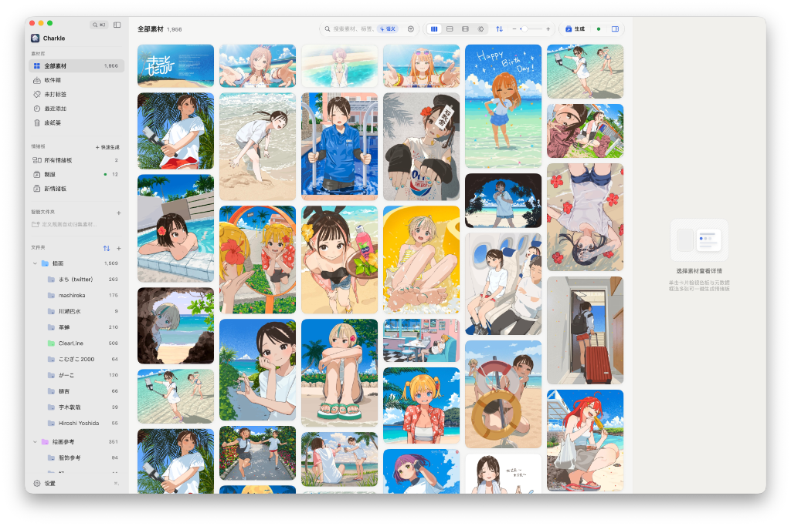
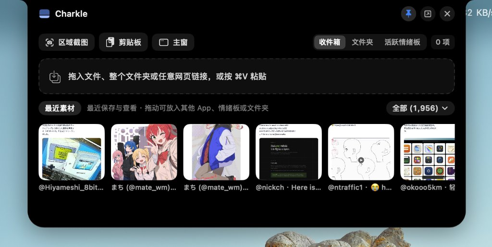
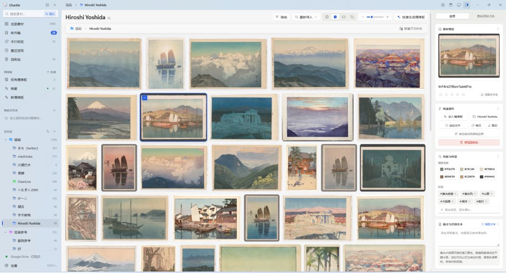

# Charkle

**顺手的全平台视觉素材库与情绪板工作台**：随手采集 · 丝滑挑图 · 快速出情绪板 · 五端无损同步

[核心特性](#核心特性) • [界面一览](#界面一览) • [下载与安装](#下载与安装) • [常用快捷键](#常用快捷键) • [云同步与扩展](#云同步与扩展) • [常见问题](#常见问题) • [多人协作与开发文档](#多人协作与开发文档)

> Charkle 是一款面向设计师、插画师与视觉创作者的**全平台视觉素材库与情绪板工作台**，现已覆盖 **macOS 原生版**、**Windows 原生版**、**iOS / iPadOS 原生版**、**Android 原生版（Alpha）** 与 **Web 自托管 / Cloudflare Workers 版**。你收藏的图片、动图、视频、音频、PDF、3D 模型与社媒/视频书签都会以开放透明的目录结构留在自己的硬盘或网盘里——不锁数据、离线可用，挑完直接拖进创作软件接着画。

 <b>主素材库画廊（macOS）</b>：高密度纯图瀑布流、左侧嵌套文件夹树与智能文件夹、顶部悬浮控制栏

---

## 核心特性

| 能干什么 | 怎么帮你省事 |
| :--- | :--- |
| **随手采集，不打断思路** | macOS 顶部刘海悬浮窗、Windows 屏幕顶边抽屉、iOS 系统分享扩展与 Android 分享接收/通知栏磁贴；把图片、文件夹或网页链接一拖就收，任意界面按快捷键即可区域截图或收藏剪贴板 |
| **6 平台社媒批量采集与浏览器抓图** | 配套 Safari（macOS 内置）与 Chrome / Edge / Arc / Brave 扩展，同机免配置自动连接；支持 **X（推特）、Pixiv、Bluesky、Threads、Instagram 与小红书**作者画作与收藏夹增量批量采集、网页抓图与取色 |
| **多视图挑图、统一检索与 Pinterest 空间探索** | 桌面端提供纵向瀑布流、横向等高、胶片挑图与 3D 环形画廊；支持按主色 / 吸管、评分、格式、中文拼音、离线 OCR 文字与视觉相似快速筛图；内置 **Pinterest 无限 2D 空间浏览器**、收藏托盘与按 Board 批量导入 |
| **收件箱闪电归档与无 AI 智能去重** | 在「收件箱」按数字键 `1`–`9` 或移动端卡片手势一秒归档；内置**全 8 类媒体无 AI 智能去重**，自动保留最高画质版本、无损合并标签与情绪板引用，淘汰副本进入可恢复回收站 |
| **全格式秒看、视频零下载流式播放与选帧设封面** | 选中素材按空格键即可全屏预览长图、GIF、视频、音频、PDF、Markdown、3D 模型、EXIF 与 AI 绘图提示词；收藏的 **YouTube / B站 / 视频网页书签**默认零下载占位，预览时直接内联流式播放并支持一键「设当前帧为封面」 |
| **快速出情绪板，直通 Figma 与 PureRef** | 支持 AI 辅助生成与微调情绪板、自动排版与自由无限画布零跳变切换、自动提取板内色卡；成品可导出高清图片、无损 `.charkleboard`（导入 Figma / FigJam 保留可编辑图层），以及 **PureRef `.pur` 双向互通**与 **`.eaglepack` / `.library` 素材包无损导入** |
| **数据归你，多后端无损双向同步** | 支持 **Google Drive**、**iCloud Drive**、**WebDAV** 与 **本地 / 挂载目录**多后端并行同步，全平台读写同一套开放 `/.charkle/` 文件结构，防删后复活，原图和整理记录始终掌握在自己手里 |
| **多端原生体验与 AI Agent 开放接口** | macOS（SwiftUI + AppKit + Metal）、iOS/iPadOS（SwiftUI + Liquid Glass）、Windows（Tauri v2 + Rust + Fluent 2）、Android（Kotlin + Jetpack Compose M3 Expressive + Rust Core）、Web（Node.js / Cloudflare Workers）；桌面与 Web 端提供 `charkle-cli` 与低 Token 20 工具 MCP 服务 |

---

## 界面一览

### macOS 原生版

**情绪板工作室**：把零散参考图快速组织成视觉方案——顶部自动提取当前画板的主色卡，画布支持自动排版与自由排布切换，底部浮岛随时添加注释、形状与导出，右侧提供 AI 策展助手与同方向候选池，边聊边替换素材。

**顶部刘海悬浮窗（Notch Shelf）**：把文件、整个文件夹或网页链接拖到 MacBook 屏幕顶部刘海即可自动展开收藏，随时切换存入「收件箱 / 文件夹 / 活跃情绪板」；不用切回主窗口，也能直接从底部「最近素材」横条把参考图拖进其他创作软件。

### Windows 原生版

**素材库画廊与检查器**：Fluent 2 桌面视觉，支持横向等高、瀑布流、胶片与 3D 环形画廊等多视图浏览；选中素材即可在右侧查看自动提取的色板、标签、备注与相似项目，并可直接按住拖出到其他创作软件（支持 `Alt+Tab` 切窗拖放）。

**情绪板工作室**：与 macOS / iOS 共用同一套情绪板格式，支持自动编排与自由画布切换、均衡/杂志/紧凑排版、板内色卡提取、右侧 AI 策展助手与候选池，跨设备无缝接续编辑。

---

## 下载与安装

前往 [GitHub Releases](https://github.com/CharTyr/Charkle/releases) 下载对应系统的安装包，或按各端说明从源码构建：

- **macOS 原生版**：要求 macOS 15.0+（Apple Silicon）。下载 `Charkle-*-arm64.dmg` 拖入「应用程序」即可；后续可在菜单栏「Charkle → 检查更新…」应用内一键升级。
- **Windows 原生版**：要求 Windows 11（推荐）或 Windows 10 64 位（x64，需 WebView2 Runtime）。下载 `Charkle_*_x64-setup.exe` 按向导安装即可。
- **iOS / iPadOS 原生版**：要求 iOS / iPadOS 18.0+，源码构建与签名说明见 [`ios/README.md`](ios/README.md)。
- **Android 原生版（Alpha）**：要求 Android 8.0+（`minSdk 26`），构建说明见 [`android/README.md`](android/README.md)。
- **Web 自托管 / Cloudflare Workers**：支持 Node.js 22.13+、Docker 与 Cloudflare Workers（Durable Object SQLite + R2），部署指南见 [`web/README.md`](web/README.md)。

首次打开后，按内置引导选定一个本地文件夹（或已有同步目录）作为素材库，马上就能开始收藏与整理。

---

## 常用快捷键

默认全局与高频操作快捷键如下（采集快捷键可在「设置」中自定义）：

| 操作 | macOS | Windows |
| :--- | :--- | :--- |
| 展开 / 收起顶部浮窗（刘海 / 顶边抽屉） | `⌥⇧S` | `Alt+Shift+S` |
| 任意界面区域截图入库 | `⌥⇧A` | `Alt+Shift+A` |
| 收藏当前剪贴板（图片或链接） | `⌥⇧V` | `Alt+Shift+V` |
| 快速跳转（搜文件夹、情绪板与功能） | `⌘J` | `Ctrl+J` |
| 全格式预览（Quick Look） | `Space` | `Space` |
| 收件箱快速归档到常用文件夹 | `1`–`9` | `1`–`9` |

---

## 云同步与扩展

- **多后端跨设备无损同步**：在「设置 → 同步」中可选 **Google Drive**、**iCloud Drive**、**WebDAV** 或 **本地 / 挂载目录**（并支持多后端并行配置）。新设备登录已有 Google Drive 素材库时，会优先并行拉取目录结构与缩略图，几秒内即可先浏览全库，原图在后台按需补齐。
- **浏览器扩展（`v1.3.0`）**：在「设置 → 插件与扩展」开启后，同机安装的浏览器扩展可自动免密配对，无需手填地址或令牌：
  - **Safari**（macOS）：正式版 `Charkle.app` 已内置原生扩展，在 Safari「设置 → 扩展」勾选启用即可。
  - **Chrome / Edge / Arc / Brave**（macOS & Windows）：在浏览器扩展页开启「开发者模式」，加载内置的 `BrowserExtension` 目录即可（详见 [浏览器扩展使用说明](Resources/BrowserExtension/README.md)）。
- **Figma / FigJam 导入**：在情绪板点击「导出 → 导出至 Figma / FigJam」生成 `.charkleboard` 文件，按「设置 → 插件与扩展」内的首次指引加载插件即可无损导入可编辑图层。
- **可选 AI 与外部工具**：AI 自动分类、打标与情绪板策展均为可选项（支持 ChatGPT 订阅账号、Gemini 与自定义兼容服务）；面向自动化与 AI Agent，桌面端与 Web 端提供 `charkle-cli` 与 20 工具 MCP 服务（详见 [Agent Skill 手册](Resources/AgentSkill/charkle/SKILL.md)）。

---

## 常见问题

**Q：不登录云盘、不配置 AI，可以纯离线使用吗？**
A：完全可以。Charkle 默认就是纯本地素材库，装好后选一个本机文件夹就能离线收藏、搜图、筛选颜色、智能去重和制作情绪板；云同步与 AI 都是按需开启的可选项。

**Q：我的图片和整理信息会被锁死在软件里吗？**
A：不会。所有原图与文件夹、标签、评分、情绪板等元数据都以开放可读的结构保存在你指定的 `/.charkle/` 目录中，随时可以备份、拷贝或迁移；同时支持 `.eaglepack` / `.library` 导入与 PureRef `.pur` 双向互通。

**Q：macOS、Windows、iOS、Android 和 Web 可以共用同一个素材库吗？**
A：可以。全平台共用同一套 `/.charkle/` 无损同步协议，接入同一个 Google Drive、iCloud Drive、WebDAV 或同步目录即可跨设备双向同步。

**Q：macOS 上按 `⌥⇧A` 区域截图没有反应怎么办？**
A：首次使用交互式区域截图需要在 macOS「系统设置 → 隐私与安全性 → 屏幕录制」中勾选允许 Charkle。如果你平时只用拖放文件、浏览器扩展或剪贴板收藏，可以不授予该权限。

**Q：GitHub Releases 里各平台的版本号有时存在短暂先后，该下哪个？**
A：桌面端安装包都会发布在同一个 [GitHub Releases](https://github.com/CharTyr/Charkle/releases) 页面。如果最新版本正在同步构建某一端安装包，向下翻看相邻版本即可找到该端的最新安装包，各端数据格式始终保持向后兼容。

---

## 多人协作与开发文档

欢迎参与多端协作开发！新加入成员请先从 **[文档总索引](docs/README.md)** 与 **[多人协作与贡献指南](CONTRIBUTING.md)** 开始：

| 文档 | 内容范围 |
| :--- | :--- |
| [**docs/README.md**](docs/README.md) | **文档总索引**：按开发角色划分的 30 秒上手阅读路径与权威层级 |
| [**CONTRIBUTING.md**](CONTRIBUTING.md) | **多人协作指南**：五端代码边界、共享核心修改规则、分支/PR 规范、质量门禁与安全红线 |
| [**docs/ARCHITECTURE.md**](docs/ARCHITECTURE.md) | **系统架构全景**：双原生核心（Swift Core + Rust Core）+ Web 双运行时架构与全子系统详解 |
| [**docs/DEVELOPMENT.md**](docs/DEVELOPMENT.md) | **全平台开发手册**：macOS / iOS / Windows / Android / Web / 扩展一键构建、测试与凭据配置 |
| [**docs/PLATFORM_MATRIX.md**](docs/PLATFORM_MATRIX.md) | **跨端版本与对齐矩阵**：当前各端版本号、功能覆盖表、核心耦合表与待认领任务单 |
| [**docs/RELEASE_AND_COLLABORATION.md**](docs/RELEASE_AND_COLLABORATION.md) | **多端协同发版规范**：版本号同步清单、预检打包与非破坏性 GitHub Release 协作流程 |
| [DESIGN.md](DESIGN.md) | 全平台产品视觉体系、动效规范与核心交互语言（[动效与图标细则](docs/MOTION_AND_ICON_SPEC.md)） |
| [AGENTS.md](AGENTS.md) | 五端总控工程护栏、仓库纯净度纪律与 macOS 原生 UI 不变量 |
| [.trellis/spec/cross-platform/index.md](.trellis/spec/cross-platform/index.md) | 跨端 `/.charkle/` 同步线协议、`.charkleboard` 情绪板格式与 20 工具 MCP 安全契约 |
| 各端专属入口 | [macOS 设计规范](.trellis/spec/macos/native-design-system.md) · [iOS/iPadOS](ios/README.md) · [Windows](windows/README.md)（[护栏](windows/AGENTS.md) / [Fluent 2](.trellis/spec/windows/fluent2-design-system.md)） · [Android](android/README.md)（[M3 Expressive](.trellis/spec/android/m3-expressive-design-system.md)） · [Web](web/README.md) · [浏览器扩展](Resources/BrowserExtension/README.md) |

---

## 支持与致谢

如果 Charkle 让你的日常找图与灵感整理更顺手，欢迎点亮一颗 Star；遇到问题或有建议，随时提交 [Issue](https://github.com/CharTyr/Charkle/issues) 或 [Pull Request](https://github.com/CharTyr/Charkle/pulls)。

- **[`gdirect`](https://github.com/mizorewww/gdirect)** — 用于 Google Drive 同步的可选直连与加速支持。

## 社区与友情链接

感谢 [LINUX DO](https://linux.do) 社区的开源分享氛围与各位佬友的支持与反馈！

[@CharTyr](https://github.com/CharTyr)
