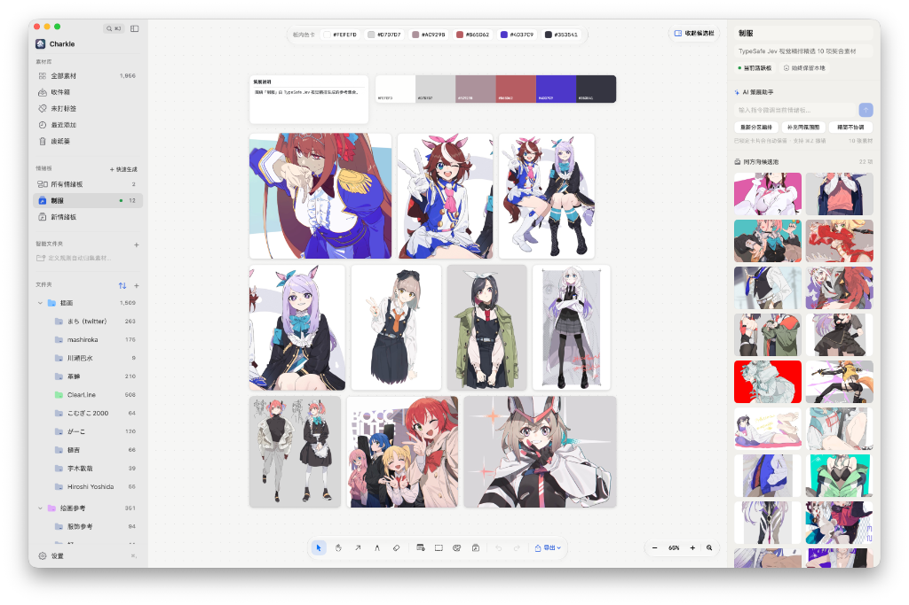

# Charkle

**顺手的桌面视觉素材库与情绪板工作台**：随手采集 · 丝滑挑图 · 快速出情绪板 · 跨端无损同步

[核心特性](#核心特性) • [界面一览](#界面一览) • [下载与安装](#下载与安装) • [常用快捷键](#常用快捷键) • [云同步与扩展](#云同步与扩展) • [常见问题](#常见问题) • [开发文档](#开发与架构文档)

> Charkle 是一款面向设计师、插画师与视觉创作者的**原生桌面视觉素材库与情绪板工具**，提供 **macOS 原生版**与 **Windows 原生版**。你收藏的图片、GIF、视频、音频、PDF 与网页灵感都会以开放透明的目录结构留在自己的硬盘或网盘里——不锁数据、离线可用，挑完直接拖进创作软件接着画。

 <b>主素材库画廊（macOS）</b>：高密度纯图瀑布流、左侧嵌套文件夹树与智能文件夹、顶部悬浮控制栏

---

## 核心特性

| 能干什么 | 怎么帮你省事 |
|------|------|
| **随手采集，不打断思路** | macOS 顶部刘海悬浮窗、Windows 屏幕顶边抽屉，把图片、文件夹或网页链接一拖就收；在任意界面按快捷键即可区域截图或收藏剪贴板 |
| **浏览器抓图与批量导收藏** | 配套 Safari（macOS 内置）与 Chrome / Edge / Arc / Brave 扩展，同机免配置自动连接；支持网页抓图、取色，以及小红书收藏、X（推特）书签一键增量批量导入 |
| **多视图挑图、多维度找图** | 提供纵向瀑布流、横向等高、胶片挑图与 3D 环形画廊（macOS）视图；支持按主色 / 吸管、评分、格式、中文拼音、离线 OCR 文字与本地视觉相似快速筛图 |
| **收件箱闪电归档** | 在「收件箱」按数字键 `1`–`9` 一秒分进常用文件夹；也支持用智能文件夹按条件自动汇总，或按需开启 AI 辅助分类与打标 |
| **空格键全格式秒看** | 选中素材按空格键即可全屏预览原尺寸长图、GIF、视频、音频、PDF、Markdown 与 3D 模型，并可查看主色板、EXIF 与常见 AI 绘图提示词参数 |
| **快速出情绪板，直通 Figma** | 支持 AI 辅助生成与微调情绪板、自动排版与自由画布随时切换、自动提取板内色卡；成品可导出高清图片，或导出无损 `.charkleboard` 导入 Figma / FigJam 保留可编辑图层 |
| **数据归你，跨设备无损同步** | 支持 Google Drive、WebDAV 与本地 / 挂载目录同步，macOS 与 Windows 读写同一套 `/.charkle/` 文件结构，原图和整理记录始终掌握在自己手里 |
| **双端原生体验** | macOS 版采用 SwiftUI + AppKit + Metal（支持应用内自动检查并一键更新）；Windows 版采用 Fluent 2 原生质感，支持 `Alt+Tab` 跨应用拖出原图 |

---

## 界面一览

### macOS 原生版

**情绪板工作室**：把零散参考图快速组织成视觉方案——顶部自动提取当前画板的主色卡，画布支持自动排版与自由排布切换，底部浮岛随时添加注释、形状与导出，右侧提供 AI 策展助手与同方向候选池，边聊边替换素材。

**顶部刘海悬浮窗（Notch Shelf）**：把文件、整个文件夹或网页链接拖到 MacBook 屏幕顶部刘海即可自动展开收藏，随时切换存入「收件箱 / 文件夹 / 活跃情绪板」；不用切回主窗口，也能直接从底部「最近素材」横条把参考图拖进其他创作软件。

### Windows 原生版

**素材库画廊与检查器**：Fluent 2 桌面视觉，支持横向等高、瀑布流与胶片等多视图浏览；选中素材即可在右侧查看自动提取的色板、标签、备注与相似项目，并可直接按住拖出到其他创作软件。

**情绪板工作室**：与 macOS 共用同一套情绪板格式，支持自动编排与自由画布切换、均衡/杂志/紧凑排版、板内色卡提取、右侧 AI 策展助手与候选池，跨设备无缝接续编辑。

---

## 下载与安装

前往 [GitHub Releases](https://github.com/CharTyr/Charkle/releases) 下载对应系统的安装包：

### macOS 原生版

- **系统要求**：macOS 15.0 及以上，Apple Silicon（M 系列芯片）。
- **安装方式**：下载最新 Release 中的 `Charkle-*-arm64.dmg`，打开镜像后将 **Charkle** 拖入「应用程序」文件夹即可使用。
- **后续更新**：无需反复手动下载，在菜单栏「Charkle → 检查更新…」或「设置 → 高级与关于」中点击 **检查更新** 即可应用内一键升级。

### Windows 原生版

- **系统要求**：Windows 11（推荐）或 Windows 10 64 位（x64），需已安装 Microsoft Edge WebView2 Runtime（Windows 11 默认自带）。
- **安装方式**：下载 Release 中的 `Charkle_*_x64-setup.exe` 安装程序，双击按向导完成安装即可启动。

首次打开后，按内置引导选定一个本地文件夹（或已有同步目录）作为素材库，马上就能开始收藏与整理。

---

## 常用快捷键

默认全局与高频操作快捷键如下（采集快捷键可在「设置」中自定义）：

| 操作 | macOS | Windows |
|:-----|:-----|:-----|
| 展开 / 收起顶部浮窗（刘海 / 顶边抽屉） | `⌥⇧S` | `Alt+Shift+S` |
| 任意界面区域截图入库 | `⌥⇧A` | `Alt+Shift+A` |
| 收藏当前剪贴板（图片或链接） | `⌥⇧V` | `Alt+Shift+V` |
| 快速跳转（搜文件夹、情绪板与功能） | `⌘J` | `Ctrl+J` |
| 全格式预览（Quick Look） | `Space` | `Space` |
| 收件箱快速归档到常用文件夹 | `1`–`9` | `1`–`9` |

---

## 云同步与扩展

- **跨设备无损同步**：在「设置 → 同步」中可选 **Google Drive**、**WebDAV** 或 **本地 / 挂载目录**（如网盘挂载盘、NAS 或同步文件夹）。新设备登录已有 Google Drive 素材库时，会优先并行拉取目录结构与缩略图，几秒内即可先浏览全库，原图在后台按需补齐。
- **浏览器扩展**：在「设置 → 插件与扩展」开启后，同机安装的浏览器扩展可自动免密配对，无需手填地址或令牌：
  - **Safari**（macOS）：正式版 `Charkle.app` 已内置原生扩展，在 Safari「设置 → 扩展」勾选启用即可。
  - **Chrome / Edge / Arc / Brave**（macOS & Windows）：在浏览器扩展页开启「开发者模式」，加载内置的 `BrowserExtension` 目录即可（详见 [浏览器扩展使用说明](Resources/BrowserExtension/README.md)）。
- **Figma / FigJam 导入**：在情绪板点击「导出 → 导出至 Figma / FigJam」生成 `.charkleboard` 文件，按「设置 → 插件与扩展」内的 3 步首次指引加载插件即可无损导入。
- **可选 AI 与外部工具**：AI 自动分类、打标与情绪板策展均为可选项，支持接入你自己的兼容模型服务；面向自动化与命令行用户，客户端同时提供 `charkle-cli` 与 MCP 能力。

---

## 常见问题

**Q：不登录云盘、不配置 AI，可以纯离线使用吗？**
A：完全可以。Charkle 默认就是纯本地素材库，装好后选一个本机文件夹就能离线收藏、搜图、筛选颜色和制作情绪板；云同步与 AI 都是按需开启的可选项。

**Q：我的图片和整理信息会被锁死在软件里吗？**
A：不会。所有原图与文件夹、标签、评分、情绪板等元数据都以开放可读的结构保存在你指定的 `/.charkle/` 目录中，随时可以备份、拷贝或迁移。

**Q：macOS 和 Windows 可以共用同一个素材库吗？**
A：可以。双端使用完全一致的 `/.charkle/` 同步协议，接入同一个 Google Drive、WebDAV 或同步目录即可在 Mac 与 Windows 之间双向同步。

**Q：macOS 上按 `⌥⇧A` 区域截图没有反应怎么办？**
A：首次使用交互式区域截图需要在 macOS「系统设置 → 隐私与安全性 → 屏幕录制」中勾选允许 Charkle。如果你平时只用拖放文件、浏览器扩展或剪贴板收藏，可以不授予该权限。

**Q：GitHub Releases 里 macOS 和 Windows 的版本号有时不一致，该下哪个？**
A：两端都会发布在同一个 [GitHub Releases](https://github.com/CharTyr/Charkle/releases) 页面。如果最新版本只包含单端更新，向下翻看相邻版本即可找到另一端的最新安装包，双端数据格式保持兼容。

**Q：支持哪些常见素材格式？**
A：支持 PNG / JPG / WebP / HEIC / SVG / GIF 等常见图片，以及视频、音频、PDF、Markdown、3D 模型与常见设计稿预览，并会自动读取 EXIF 及主流 AI 生图工具保存的提示词参数。

---

## 开发与架构文档

如果你希望参与开发、从源码构建或了解各端架构与协议细节，请直接查阅对应文档：

| 文档 | 内容范围 |
|:-----|:-----|
| [DESIGN.md](DESIGN.md) | 产品视觉体系、动效规范与核心交互语言 |
| [docs/BLUEPRINT.md](docs/BLUEPRINT.md) | 产品整体架构蓝图与核心模块设计 |
| [docs/MOTION_AND_ICON_SPEC.md](docs/MOTION_AND_ICON_SPEC.md) | 动效曲线与图标设计细则 |
| [.trellis/spec/cross-platform/index.md](.trellis/spec/cross-platform/index.md) | 跨端 `/.charkle/` 同步协议、`.charkleboard` 情绪板格式与 MCP 契约 |
| [.trellis/spec/macos/native-design-system.md](.trellis/spec/macos/native-design-system.md) | macOS 原生端（SwiftUI + AppKit + Metal）设计系统与工程规范 |
| [windows/README.md](windows/README.md) | Windows 原生端（Tauri v2 + Rust + React）架构与目录说明 |
| [.trellis/spec/windows/fluent2-design-system.md](.trellis/spec/windows/fluent2-design-system.md) | Windows 原生端 Fluent 2 设计系统与交互规范 |
| [Resources/BrowserExtension/README.md](Resources/BrowserExtension/README.md) | Safari / Chromium 浏览器扩展说明与测试 |

---

## 支持与致谢

如果 Charkle 让你的日常找图与灵感整理更顺手，欢迎点亮一颗 Star；遇到问题或有建议，随时提交 [Issue](https://github.com/CharTyr/Charkle/issues) 或 [Pull Request](https://github.com/CharTyr/Charkle/pulls)。

- **[`gdirect`](https://github.com/mizorewww/gdirect)** — 用于 Google Drive 同步的可选直连与加速支持。

[@CharTyr](https://github.com/CharTyr)
