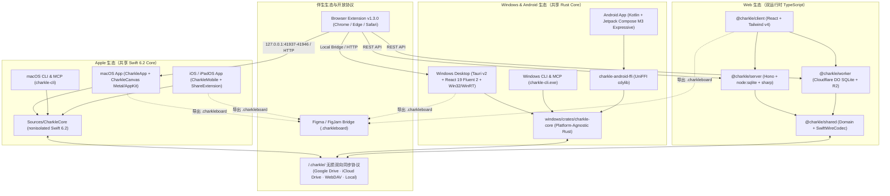

# Charkle 系统架构全景（Architecture）

> **当前基线**：macOS `v1.5.1` · iOS/iPadOS `v1.5.1` · Windows `v1.5.1` · Android `v1.5.0-alpha01`（已合入主干，持续迭代中） · Web（Node.js / Docker / Cloudflare Workers） · Browser Extension `v1.3.0`  
> 本文档描述 Charkle 当前真实的五端与伴生插件架构，替代早期仅面向 v1.0 macOS 的规划稿 [`BLUEPRINT.md`](BLUEPRINT.md)。

---

## 1. 总体架构：双原生核心 + 全栈 Web + 统一开放协议

Charkle 的设计原则是 **「统一核心 + 宿主原生壳层（同魂不同壳）+ 开放可读数据格式」**：

- **Apple 生态共享 Swift 核心**：`Sources/CharkleCore`（Swift 6.2 `nonisolated`）同时驱动 **macOS 原生桌面端** 与 **iOS / iPadOS 原生移动端**。
- **非 Apple 原生生态共享 Rust 核心**：`windows/crates/charkle-core`（Rust 1.85，零 OS 依赖）同时驱动 **Windows 原生桌面端**（Tauri v2 + Win32/WinRT）与 **Android 原生移动端**（UniFFI + Kotlin / Jetpack Compose）。
- **Web 生态采用双运行时 TypeScript 核心**：`web/packages/shared` + `web/packages/server` 通过抽象存储/图像接口同时运行在 **自托管 Node.js / Docker** 与 **Cloudflare Workers（Durable Object SQLite + R2）** 上。
- **五端通过一套开放可读的 `/.charkle/` 协议无损双向同步**：所有原图按人类可读文件夹存放，增量日志与情绪板 JSON 采用统一的 Swift 线格式（Cocoa Reference Epoch + 大写 RFC-4122 UUID + HLC 冲突收敛）。



---

## 2. Monorepo 目录结构总览

```text
Charkle/
├── Package.swift                        # SwiftPM 6.2 定义（CharkleCore / CharkleCanvas / CharkleApp / CharkleCLI / CharkleTests）
├── Sources/
│   ├── CharkleCore/                     # Apple 共享纯核心库（macOS + iOS 共用，禁止 import SwiftUI）
│   │   ├── Contracts/                   # CoreModels, MediaModels, MoodboardModels, SyncModels, CoreServiceProtocols
│   │   ├── Database/                    # SQLiteConnection, LibraryDatabase (WAL + FTS5 + 拼音), AssetVector
│   │   ├── Media/                       # MediaPipeline, ImageMetadataExtractor, SmartDeduplicator, EaglePackImporter,
│   │   │                                # PureRefCodec, VideoPlatformResolver, SocialPostResolver, X/XHS/GitHub/Web 解析器
│   │   ├── Sync/                        # DriveSyncEngine, SyncOperations, DirectAPITransport, ICloudDriveTransport,
│   │   │                                # WebDAVTransport, MountedVolumeTransport, GoogleOAuthClient, GDirectIntegration
│   │   ├── Intelligence/                # ColorExtractor, VisionAnalyzer, MoodboardCurator, MoodboardAgentHarness,
│   │   │                                # CloudAIProvider, ChatGPTSignInClient, VisualGrounding, ExternalAgent/MCP
│   │   ├── Services/                    # LocalExtensionBridgeServer, GitHubReleaseUpdater, Pinterest/*
│   │   └── LiveCharkleEngine.swift      # 统一引擎编排入口
│   ├── CharkleCanvas/                   # macOS 高帧率渲染（AppKit 虚拟化瀑布流、Metal 3D 环形画廊、双模情绪板、Figma 导出）
│   ├── CharkleApp/                      # macOS 壳层（SwiftUI 视图、@Observable Stores、Notch Shelf、Quick Look、设置页）
│   └── CharkleCLI/                      # macOS 独立命令行与 MCP stdio 服务（charkle-cli）
├── Tests/CharkleTests/                  # Swift Testing 测试套件（36 个测试文件覆盖核心/同步/画布/性能/回归）
├── ios/
│   ├── CharkleMobile.xcodeproj/         # iOS / iPadOS Xcode 工程（直接依赖根目录 SwiftPM CharkleCore）
│   ├── CharkleMobile/                   # 自适应主壳、Liquid Glass 变形底栏、画廊/收件箱/预览/情绪板/Pinterest/多后端同步
│   └── CharkleShareExtension/           # iOS 系统分享扩展（从小红书/X/Safari/相册一键入库）
├── windows/
│   ├── Cargo.toml                       # Rust Workspace（charkle-core / charkle-platform-win / charkle-cli / src-tauri）
│   ├── crates/
│   │   ├── charkle-core/                # 平台无关 Rust 核心（Windows 与 Android 共同依赖）
│   │   ├── charkle-platform-win/        # Win32/WinRT 桥（Mica、DPAPI 凭据库、WinRT OCR、Shell 缩略图、OLE 拖放、顶边抽屉）
│   │   └── charkle-cli/                 # Windows 独立 CLI 与 MCP stdio（charkle-cli.exe）
│   ├── src-tauri/                       # Tauri v2 宿主、IPC Commands、charkle-media:// 流式协议、NSIS 配置
│   ├── ui/                              # React 19 + TypeScript + Tailwind v4 + Base UI Fluent 2 前端
│   └── scripts/                         # verify-windows.ps1, build-release-nsis.ps1, sync-icons.mjs
├── android/
│   ├── rust/charkle-android-ffi/        # 独立 UniFFI crate（引用 ../../../windows/crates/charkle-core，不侵入 Windows Workspace）
│   ├── app/                             # Kotlin + Jetpack Compose M3 Expressive UI、ShareReceiveActivity、QSTile、Glance 微件
│   └── scripts/                         # build-rust-android.sh, verify-android.sh, build-release-android.sh
├── web/
│   ├── packages/shared/                 # @charkle/shared（模型、CIELAB、SmartFolderRule、EditorialSolver、SwiftWireCodec）
│   ├── packages/server/                 # @charkle/server（Hono + node:sqlite + sharp + 同步引擎 + MCP stdio）
│   ├── packages/client/                 # @charkle/client（React + Tailwind v4 + Zustand）
│   ├── packages/worker/                 # @charkle/worker（Cloudflare Workers + Durable Object SQLite + R2 + Alarm）
│   ├── packages/extension/              # Web 端独立构建的浏览器扩展副本
│   └── figma-plugin/                    # 与 Resources/FigmaPlugin 逐字节同步的 Figma 桥接插件
├── Resources/
│   ├── BrowserExtension/                # 共享 MV3 浏览器扩展 v1.3.0（6 平台社媒批量采集 + 单页剪藏 + 本地免密配对）
│   ├── SafariExtension/                 # macOS 原生 Safari Web Extension 封装工程文件
│   ├── FigmaPlugin/                     # 权威 Figma / FigJam .charkleboard 桥接插件
│   ├── AgentSkill/charkle/              # 外部 AI Agent 低 Token 使用手册（SKILL.md）
│   └── AppIcons/                        # 多风格应用图标资源
├── scripts/                             # macOS 构建、签名、DMG 打包、Safari 扩展编译、Figma 插件校验脚本
├── docs/                                # 工程文档中枢（本目录）
└── .trellis/                            # 分层编码规范（spec/）、跨端任务单（tasks/）与工作流脚本
```

---

## 3. 核心业务子系统详解

### 3.1 本地数据库与统一检索（`LibraryDatabase`）

- **底层引擎**：macOS/iOS 直连系统 `libsqlite3`，Windows/Android 使用 `rusqlite`（`bundled` + `modern_sqlite`），Web 使用 Node.js 22.13+ 内置 `node:sqlite` 或 Cloudflare Durable Object SQLite，统一开启 `WAL` 模式。
- **核心表职责**：
  - `assets`：素材规范记录（大写 UUID、`mediaKind`、尺寸、时长、主色 CIELAB、评分、离线置顶、`driveFileID`、`contentHash`、逻辑文件夹路径、`updatedHLC`、软删除与墓碑状态、富元数据 JSON）。
  - `assets_fts`：FTS5 全文检索表，索引标题、备注、标签、离线 OCR 文本、来源域名与**中文拼音/首字母分词**（`SearchText`）。
  - `asset_vectors`：跨端共享的特征向量分片；注意 Windows 本地视觉指纹存放在严格本机的 `local_visual_descriptors` 表，不污染 Apple Vision `feature_print` 列。
  - `folders` / `smart_folders` / `boards`：嵌套文件夹树、动态规则智能文件夹（`SmartFolderRule`）与情绪板文档缓存。
  - `sync_state`：各同步后端游标（如 Drive `startPageToken`）、已消费 `ops` 序号、防复活删除墓碑与待上传队列。

### 3.2 全媒体管线、两级缓存与格式生态（`MediaPipeline`）

- **8 大规范媒体类型（`MediaKind`）**：
  1. `image`（PNG / JPG / HEIC / WebP / TIFF / AVIF / JXL 等）
  2. `animatedImage`（GIF / APNG）
  3. `video`（MP4 / MOV / M4V / WebM / MKV / AVI）
  4. `webBookmark`（网页书签、GitHub 仓库、8 大社媒/视频平台富卡片）
  5. `document`（PDF / Markdown / Office / 文本 / 配置）
  6. `designFile`（SVG / PSD / PSB / Sketch / Fig / AI / EPS / Affinity）
  7. `audio`（MP3 / WAV / M4A / FLAC / OGG / OPUS 等，含峰值波形提取）
  8. `model3D`（USDZ / OBJ / STL / GLTF / GLB / FBX / Blend 等）
- **两级缓存体系**：
  - **缩略图层（常驻本机）**：`grid520`（高分屏 720px 档）+ `preview1400`（1400px 大图档），保障离线秒览瀑布流与情绪板。
  - **原文件层（按需流式 + LRU 淘汰）**：默认 10 GB 预算上限可调；单素材或整块情绪板支持「钉选离线（`pinnedOffline`）」免于 LRU 回收。
- **元数据与解析器矩阵**：
  - **EXIF & AI 生图提示词**：自动解析相机 EXIF 以及常见 AI 生图元数据（Prompt / Negative Prompt / Model / Seed / Steps / CFG / Sampler）。
  - **8 大社媒与视频平台（`SocialPlatform`）**：`x`、`threads`、`bluesky`、`xiaohongshu`（3:4 垂直卡片与 `Referer` 媒体代理）、`pixiv`、`instagram`、`youtube`、`bilibili`，外加 GitHub 仓库与通用网页 3 级缩略图回退管线。
  - **视频书签零下载流式播放 & 设当前帧为封面（v1.5.1）**：默认仅存链接、封面、时长与视频摘要/章节（零下载占位）；预览时优先走原生 HTTP Range/HLS 直链流式播放，不可用时自动降级官方 Embed 播放器；支持对**本地视频与流式视频书签**一键截取当前帧设为素材封面，立即重算主色与双档缩略图并触发跨端同步。
  - **无 AI 全媒体智能去重（`SmartDeduplicator`）**：纯确定性算法覆盖全 8 类媒体（内容哈希 + 感知指纹 + 元数据质量评分），自动保留最高画质版本并无损合并标签、备注、文件夹与情绪板引用，淘汰副本默认进可恢复回收站。
  - **第三方格式互通**：支持无损导入 `.eaglepack` / `.library` 素材包（`EaglePackImporter`），以及 **PureRef `.pur`** 双向编解码导入/导出（`PureRefCodec`）。

### 3.3 多后端无损双向同步引擎（`DriveSyncEngine`）

- **5 种同步传输模式（`DriveTransportMode`）**：
  - `directAPIWithGDirect`（Google Drive API v3，支持共享文件夹协作、元数据与缩略图优先的渐进式冷启动、可选 `gdirect` 低延迟 IP 加速）
  - `iCloudDrive`（macOS / iOS 原生 iCloud Drive 容器 + Windows iCloud Drive 目录）
  - `webDAV`（Nextcloud / NAS / 各类标准 WebDAV）
  - `gdirectMount`（兼容挂载卷，带 POSIX `st_dev` 防误写校验）
  - `localOnly`（纯本地或自定义同步文件夹）
- **多后端并行（`SyncBackendProfile`）**：单库支持同时配置多个独立同步档案（如 Google Drive + iCloud Drive + WebDAV 并存）。
- **开放目录结构与冲突收敛**：
  ```text
  <LibraryRoot>/
  ├── Inbox/                               # 未归类缓冲区
  ├── <UserFolder>/...                     # 1:1 映射真实文件夹树（POSIX '/' 逻辑路径）
  └── .charkle/
      ├── manifest.json                    # 协议版本、目录映射、根 Folder ID
      ├── ops/ops-<deviceId>-<seq>.jsonl   # 按设备分片追加的 HLC 增量操作日志
      ├── boards/<board-uuid>.json         # 单情绪板独立文件（板间零冲突）
      ├── thumbnails/<asset-uuid>.jpg      # 云端共享缩略图（新设备秒开首屏）
      └── vectors/                         # 向量分片
  ```
- **核心不变量**：标量字段 HLC `(time, device)` LWW；标签集合与删除状态使用墓碑集合（防云端旧设备“复活”已彻底删除的素材）；云端改名/移动通过 `driveFileID` + `contentHash` 追踪，情绪板引用永不断链。

### 3.4 渲染、画廊、情绪板与 Pinterest 空间浏览

- **4 种桌面画廊视图**：纵向虚拟化瀑布流（锚定精确卡片的 Photos 式丝滑缩放）、横向等高（Justified）、胶片挑图（Filmstrip）、以及桌面端 3D 环形画廊（macOS Metal `RingGalleryMetalView` / Windows WebGL）。
- **双模情绪板工作室**：单源引用 `assetUUID`（绝不复制原图），支持 **自动排版（均衡/杂志/紧凑）⇄ 自由无限画布** 零跳变切换，内置 5 套便签、分组框、自动色卡带、磁吸连线、手绘墨水笔迹、右键「在素材库中定位」、以及高清 PNG / `.charkleboard`（Figma/FigJam 可编辑图层）/ PureRef `.pur` 导出。
- **Pinterest 无限 2D 空间浏览器**：120Hz 自由平移与焦点缩放画布、购物车式「托盘」、登录会话桥接、按 Board 一键批量建文件夹导入。

### 3.5 混合 AI、浏览器扩展桥接与外部 Agent（CLI / MCP）

- **端侧常驻（离线零成本）**：CIELAB 主色与 CIEDE2000 容差搜索、离线 OCR（Apple Vision / WinRT `OcrEngine` / Android ML Kit）、中文拼音、本地视觉相似检索。
- **云端增强（可选，密钥仅存系统安全库）**：支持 ChatGPT 订阅账号 PKCE OAuth、Google Gemini 与自定义 OpenAI 兼容接口，用于自动打标、语义检索与情绪板策展助手。
- **同机免密浏览器扩展桥接**：桌面端在回环端口 `127.0.0.1:41937–41946` 暴露与 Web 一致的 `/api/v1/*` 接口；`POST /api/v1/auth/local-pair` 强制校验扩展 `Origin`（`chrome-extension://`、`safari-web-extension://`、`moz-extension://`）及 `X-Charkle-Extension: 1`，拒绝一切普通网页请求。
- **纯 MCP v2 双通道 + Skill（10 工具 · 5+2 资源 · 5 提示词）**：统一遵循 [`.trellis/spec/cross-platform/index.md` §3](../.trellis/spec/cross-platform/index.md#3-external-agent-pure-mcp-v2-safety--contract-10-tools--52-resources--5-prompts)，全面退役复杂业务 CLI 子命令，保留**本机极薄 `stdio` MCP 助手**（App 退出亦可查库）+ **跨机器 Streamable HTTP MCP（`/api/v1/mcp` + 独立作用域密钥 + 临时签名下载）**，支持 8 位短 ID、一跳 Contact Sheet、会话去重、异构批量整理（含 `dry_run`）、去重视觉裁决与 `rollback_run` HLC 跨端回滚，且**永久禁止任何彻底删除资产或删文件夹操作**。
