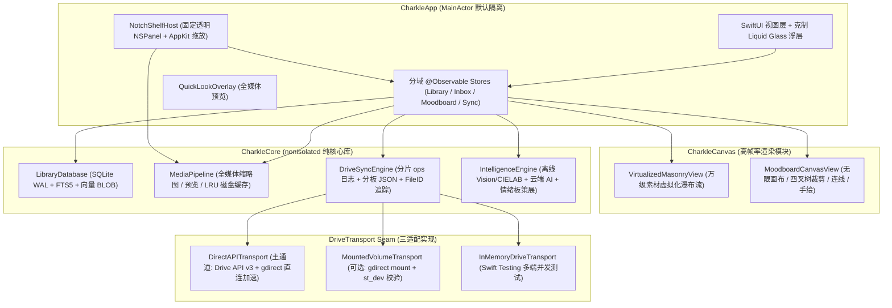
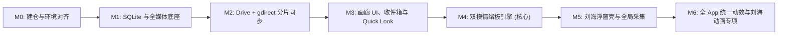

# Charkle v1.0 产品与架构规划蓝图

> **状态**：规划评审稿（确认后再开始建仓与编码）  
> **应用名称**：**Charkle**（Bundle ID: `com.charkle.app` · URL Scheme: `charkle://` · Drive 根目录: `/Charkle/`）  
> **目标平台**：macOS 15+（Apple Silicon，优先适配 macOS 原生 Liquid Glass 与 Swift 6.4 并发模型）  
> **仓库结构**：统一多端 Monorepo（macOS 原生、Web 版、Windows 原生规划）

---

## 1. 产品灵魂与 v1.0 范围边界

### 核心差异化：从「素材囤积库」到「10 秒情绪板创作台」
传统参考图工具擅长收集，白板工具擅长排布，但两者之间存在明显断层。**Charkle** 把两条链路合为一体，并以**人类可读的 Google Drive** 作为多端云底座：

1. **素材库（Library）**：长期全媒体视觉记忆（图片、动图/短视频、网页快照、PDF/排版/色卡、音频与 SVG/PSD/Figma 链接），原始文件在 Google Drive 中按真实文件夹清晰存放。
2. **收件箱（Inbox）**：零摩擦采集缓冲区（`/Charkle/Inbox/`）+ 高效键盘/AI 归档清理台，也是情绪板的快速供血通道。
3. **情绪板（Moodboard — 核心杀手锏）**：建立在素材库之上的**活的创作面板**——支持 4 种入口秒生成排版初稿、随时切换自由画布加便签/分组/连线/手绘批注，并可设为「当前活跃情绪板」持续从全系统往里生长内容。

### v1.0 范围（锋利主力版）vs 延后项

| 阶段 | 包含范围 | 明确原则 |
| :--- | :--- | :--- |
| **v1.0 核心主干** | ① 全媒体素材库 + 虚拟化瀑布流 + 视觉/色彩/比例/类型筛选 + `⌘J` 快速跳转<br>② **双模情绪板**（4 入口秒生成 + 候选替换池 + 自由画布/便签/分组/连线/手绘 + 自动色卡 + 导出/拖入 Figma）<br>③ **Google Drive + `gdirect` 双通道** + SQLite(FTS5/向量) + LRU 缓存 + 分片增量同步<br>④ **收件箱清理台** + **刘海浮窗（动画友好容器）** + **Quick Look (`Space`)** + 全局快捷键<br>⑤ **混合 AI**（端侧 CIELAB/Vision OCR/`VNFeaturePrint` 离线常驻 + 可选云端 Gemini/OpenAI） | 先把日常最高频的「收 → 找 → 成板 → 同步」打磨到无短板 |
| **v1.0 专项收尾** | **全 App 统一动效与物理手感专项**（含 MacBook 刘海弹簧形变动画、Quick Look 景深过渡、情绪板自动↔自由流式重排、Liquid Glass 容器融合） | 架构期先预留物理友好的容器与动效 Token，核心稳定后统一雕琢 |
| **v1.1+ 规划** | ① 内置端侧媒体工具箱（`⌘K` 抠图/压缩/裁剪/去 EXIF）<br>② 浏览器扩展站点深度适配（X / Pinterest / 小红书 / Dribbble / GitHub / B站，Chrome & Safari）<br>③ 面向 AI Agent 的 MCP Server 与 CLI | 底层预留清晰接口，不拖慢 v1.0 主线质量 |

---

## 2. 情绪板（Moodboard）产品与交互设计

### 2.1 四种「秒生成」入口 + 候选替换池
- **入口**：
  1. **灵感词生板**：输入创作主题/氛围词（如「京都雨夜霓虹」「低饱和奶油陶瓷」）。
  2. **以图生板**：选 1–3 张定调种子图，基于 `VNFeaturePrint` 视觉特征 + CIELAB 配色相近度拉出同氛围素材。
  3. **以色生板**：点选 1–3 个主色调 + 容差，秒建色彩情绪板。
  4. **框选成板**：在素材库框选一批素材直接一键生成。
- **混合策展算法（离线可用，接云端 AI 更准）**：
  - 综合打分 = 云端语义向量相似度（可选） + FTS5/标签/OCR 命中 + Apple Vision `VNFeaturePrint` 视觉接近度 + CIELAB ΔE 色彩和谐度。
  - 引入 **MMR 多样性惩罚**（防止 15 张结果全是同一组连拍截图）。
- **初稿 + 候选替换池（AI 提议、人拍板）**：
  - 主画布默认排入 **12–20 张**最佳素材，并自动提取整板 **5–7 个和谐主色卡** 形成板顶/板内色卡条。
  - 右侧检查器自动展示 **20–40 张同方向候选池**：不满意画布中某张图时，一键点击即可原地替换，或拖入追加，不破坏已有节奏。

### 2.2 混合双模画布（Auto Editorial ↔ Freeform Infinite Canvas）
- **自动排版模式（默认初稿态）**：
  - 按图片原始宽高比与视觉权重（支持标记 1–2 张 Hero 大图）自动排成杂志拼贴 / Bento 网格，边缘对齐、留白克制，0 排版负担。
  - 支持直接拖拽调序、切换紧凑/呼吸感间距、原地换图。
- **自由画布模式（随时一键切换，无跳变）**：
  - 切换瞬间以当前自动排版坐标作为起点，零视觉跳变进入无限缩放/平移画布（支持触控板双指捏合缩放与惯性平移、智能对齐参考线、框选多选）。
  - **支持 5 类画布节点与标注**：
    1. **素材引用节点**（图片、悬停/循环播放的 GIF/短视频、网页快照卡、PDF 首页/翻页预览、音频波形卡、SVG/PSD 预览，支持非破坏性裁切框）。
    2. **文字便签与标题卡**（氛围词、字体/排版灵感摘录、Brief）。
    3. **区域分组框（Section Frame）**（如「构图」「材质」「配色」「字体」，拖动框头整体移动内部元素）。
    4. **自动全板色卡条**（一键复制 HEX、反向以该色搜库）。
    5. **白板式箭头连线 + 手绘批注**（节点边缘磁吸连接点、贝塞尔曲线箭头/说明标签、平滑压感矢量笔迹）。
  - 随时支持对选中元素或整板执行「重新整齐排版」，完整接入 `UndoManager` 撤销栈（受益于值类型文档模型）。

### 2.3 活板工作流与纯引用单源模式
- **单源引用，绝不重复存原文件**：
  - 情绪板仅保存轻量画布文档（`/.charkle/boards/<board-uuid>.json`），按 `assetUUID` 引用素材库内容；同一张素材被 5 个情绪板引用，Google Drive 里依然只占 1 份原文件空间。
  - 从 Finder / 浏览器直接把**新外部文件**拖入某情绪板时：自动入库到 `/Charkle/Inbox/`（同步生成缩略图、色彩与索引），并立刻以节点形式落在画布光标位置。
- **设为「当前活跃情绪板」**：
  - 刘海浮窗支持一键锁定目标为「收件箱 / 指定文件夹 / 当前活跃情绪板」。
  - 锁定后，区域截图、剪贴板粘贴、拖入刘海的所有新灵感会**自动落入 `/Charkle/Inbox/` 并实时追加进当前情绪板**。
- **导出与创作交接**：
  - 一键导出高分辨率拼贴图（PNG/JPG，支持 2x Retina 与隐藏/保留批注开关）。
  - 一键复制整板高清图或选中区域，直接 `⌘V` 粘贴或拖入 Figma / Keynote / Freeform。

---

## 3. 系统架构与深模块划分

遵循 **Deep Modules（深模块）** 与 **Swift 6.2/6.4 渐进并发** 原则：小接口封装复杂实现、只在存在 ≥2 个真实 Adapter 的位置引入 Seam、UI 与非 UI 严格分离，淘汰原型中 1,433 行的巨型 `LibraryViewModel`。



### 3.1 包与目标规划（SwiftPM）
| Target | 默认隔离 | 职责 |
| :--- | :--- | :--- |
| **`CharkleCore`** | `nonisolated` | 值类型领域模型、`LibraryDatabase`、`MediaPipeline`、`DriveSyncEngine`、`IntelligenceEngine`；不依赖 SwiftUI，全部可通过 Swift Testing 毫秒级并行验证 |
| **`CharkleCanvas`** | `@MainActor` + 后台光栅化 | AppKit/CoreGraphics/Metal 加速的**虚拟化瀑布流**与**双模情绪板无限画布**（含空间索引裁剪、手绘笔迹拟合、高 DPI 导出） |
| **`CharkleApp`** | `@MainActor` | 窗口架构、侧栏、Liquid Glass 浮层控制条、收件箱清理台、Quick Look、刘海面板宿主、设置页 |
| **`CharkleTests`** | Swift Testing | 跨模块接口测试（内存 SQLite + `InMemoryDriveTransport` 模拟双端冲突/网页改名/缓存淘汰/情绪板策展） |

### 3.2 五大深模块关键设计

#### 模块 A：`LibraryDatabase`（本地存储与检索）
- **技术选型**：直接基于 macOS 系统内置 `libsqlite3`（零外部重型依赖、编译极快），开启 `WAL` 模式与严格 schema 版本迁移。
- **表与索引**：
  - `assets`（`uuid`, `drive_file_id`, `content_hash`, `folder_path`, `media_kind`, `width`, `height`, `duration`, `dominant_lab_blob`, `rating`, `pinned_offline`, `updated_hlc`, `deleted_at`）
  - `assets_fts`（FTS5 虚拟表：标题、备注、标签、OCR 文本、来源域名、**中文拼音与首字母分词**）
  - `asset_vectors`（`VNFeaturePrint` 字节与云端 float16 语义向量 BLOB，支持加速余弦相似度检索）
  - `boards`（情绪板元数据索引 + 完整文档 JSON 缓存 + `pinned_offline` 标记）
  - `sync_state`（Drive `startPageToken`、各设备已消费 `ops` 序列号、待上传队列）
- **规模目标**：5,000–50,000+ 素材下，冷启动 < 300ms，关键词/拼音/颜色/组合筛选 < 20ms。

#### 模块 B：`MediaPipeline`（全媒体管线与两级本地缓存）
- **按 `MediaKind` 统一抽取缩略图、元信息与预览能力**：
  - **静态图**（PNG/JPG/HEIC/WebP/TIFF/AVIF）：`ImageIO` 硬件下采样 + EXIF + CIELAB 配色。
  - **动图与短视频**（GIF/APNG/MP4/MOV/WebM）：首帧海报 + 时间轴多帧预览条 + 悬停静音循环预览。
  - **网页书签 / Figma 链接**：解析 OpenGraph / 标题 / Favicon + `WKWebView` 首屏快照缓存 + 一键打开原链接。
  - **文档与设计源文件**（PDF/SVG/PSD/Sketch/AI/Keynote）：`PDFKit` / CoreGraphics SVG 渲染 + `QLThumbnailGenerator` 原生系统缩略图兜底。
  - **音频**（MP3/WAV/M4A/FLAC）：`AVAsset` 时长与降采样峰值波形数组（卡片与情绪板内直接可视化波形播放）。
- **两级本地缓存策略**：
  1. **缩略图层（常驻本地）**：统一 520px WebP/JPEG（单张约 30–60 KB，20,000 张仅约 1 GB），离线也能秒览全部瀑布流与情绪板。
  2. **原文件层（按需下载 + LRU 自动淘汰）**：默认缓存上限 **10 GB**（设置中可调 2 GB–100 GB）；打开 Quick Look、拖出原文件或播放视频时按需流式拉取；支持对**单条素材或整个情绪板开启「钉选离线」**，受保护文件永不参与 LRU 回收。

#### 模块 C：`DriveSyncEngine`（Google Drive + `gdirect` 双通道与分片增量同步）

**云端 Google Drive 目录结构（人类可读 + 防冲突分片）**：
```text
Google Drive /
└── Charkle/
    ├── Inbox/                         # 未归类缓冲区（网页/手机直扔文件也会自动发现并建索引）
    ├── <用户文件夹>/                   # 1:1 映射真实目录（支持多级子目录）
    └── .charkle/
        ├── manifest.json              # 协议版本、目录映射、根 Folder ID
        ├── ops/
        │   └── ops-<deviceId>-<seq>.jsonl  # 每设备独立追加式增量变更日志（无覆盖冲突）
        ├── snapshots/
        │   └── state-<ts>.json.gz     # 定期压缩快照（新 Mac 登录时秒拉全量状态）
        ├── boards/
        │   └── <board-uuid>.json      # 每个情绪板独立文件（板间修改零冲突）
        ├── embeddings/
        │   └── shard-<00..ff>.bin     # 按 UUID 前缀分片存储向量（只传变动分片）
        └── thumbnails/
            └── <asset-uuid>.jpg       # 云端共享缩略图，跨设备零等待首屏
```

**双通道策略（`DriveTransport` Seam）**：
1. **主通道：`DirectAPITransport`（零挂载、高稳定、默认推荐）**
   - 直接走 Google Drive API v3（支持 `Changes.list` 增量游标、断点续传、Range 流式读取视频），不依赖操作系统级 FUSE/rclone 挂载，彻底告别断网卡死 Finder。
   - **深度协同 `gdirect v0.13.2`**：自动读取 `gdirect` 扫描出的低延迟直连 Google IP 对 API 请求加速，并支持检测/协同本机 `gdirect` 账号与版本状态（自动识别 CLI `0.1.2` vs `gdirect.app 0.13.2` 差异并引导一键升级）。
2. **可选通道：`MountedVolumeTransport`**
   - 保留给习惯通过 `gdirect mount` 或官方 Google Drive 桌面版在 Finder 直接操作文件的用户；沿用原型验证过的 **POSIX `st_dev` 严格挂载校验**，杜绝未挂载目录误写本机磁盘或误报 SSD 容量的坑。

**多端并发与网页端手动操作处理**：
- **网页/手机端改名或移动文件**：通过不可变 `driveFileId`（辅以 `contentHash` 兜底）追踪，自动更新本地记录的路径与名称，**情绪板引用关系 100% 不中断**。
- **网页/手机端往 `/Charkle/` 新扔文件**：增量同步自动发现并入库、本地后台补齐缩略图/CIELAB/OCR 并回传 `/.charkle/thumbnails/`。
- **两台 Mac 同时改标签或编辑情绪板**：
  - 资产元数据按 `ops-<deviceId>-<seq>.jsonl` 追加合并，标量字段走时间戳 LWW，标签集合走 Add/Remove 墓碑集合合并（两台设备各加一个标签会保留两个，不覆盖）。
  - 情绪板拆分为独立 JSON，板内按节点 UUID 与操作时间戳合并，极端冲突时保留可对比副本绝不静默丢数据。

#### 模块 D：`IntelligenceEngine`（混合 AI）
- **端侧常驻（零配置、零费用、隐私安全）**：`ColorExtractor`（CIELAB 感知色板 + ΔE2000）、`VisionAnalyzer`（Apple Vision 中英文 OCR + `VNFeaturePrint` 视觉特征）、中文拼音分词。
- **云端增强（完全可选，Keychain 存储密钥）**：支持 Gemini（默认推荐多模态 + Embedding）与 OpenAI / Ollama 兼容接口；仅当用户主动开启时才发送低分辨率缩略图或文本元数据生成双语描述、建议标签、推荐归属文件夹与语义向量。

#### 模块 E：收件箱与刘海浮窗（面向工作流重构）
- **收件箱清理台**：侧栏显示真实未归类计数角标；进入后顶部展示轻量归档条，支持 `1–9` 快捷移入常用 Drive 文件夹、一键采纳 AI 推荐目录/标签、一键投入某情绪板、批量清空，彻底消除「收件箱形同虚设」的问题。
- **刘海浮窗（动画友好底层壳）**：
  - 从设计第一天采用**固定大尺寸透明 `NSPanel`** 贴合 `screen.frame.maxY`，所有收起/展开仅驱动内部 SwiftUI/CA 几何形变（绝不生硬改 `NSWindow` frame），确保后续动效专项可以直接注入弹簧物理与 Dynamic Island 式丝滑融合。
  - 保留原型已验证的两大核心机制：**AppKit `NotchDropHostingView`（`NSDraggingDestination`）** 解决后台跨 App 拖放，以及 **`NSPasteboard(.drag).changeCount` 监听**提前滑出以彻底规避触发 macOS Mission Control 切屏。

---

## 4. 视觉语言与克制 Apple Liquid Glass 规范

结合 **Gallery-First 克制画廊风**、`apple-design`（流体反馈、层级材质、光学字距、无障碍退化）与 **克制 Apple Liquid Glass**（基于 macOS 26+ 原生 `.glassEffect` / `GlassEffectContainer` / `.scrollEdgeEffectStyle(.soft)`，macOS 15 优雅回退原生 `Material`）：

### 4.1 材质分层原则（克制核心：**绝不玻璃叠玻璃，绝不污染看图色彩**）

| 界面区域 | 材质策略 | 原因 |
| :--- | :--- | :--- |
| **主画廊底板 & 情绪板画布** | **纯净低饱和中性实色**（亮色微暖灰白 / 暗色中性炭灰，无紫调/渐变底噪） | 保证设计师判断图片色彩、明度与构图时零色偏干扰 |
| **素材卡片本体** | **纯净无装饰 + 连续圆角（Continuous Corner）**，默认隐藏冗余文字标题，悬停/选中时呈现克制状态指示 | 让作品本身当主角，消除 AI 模板感与视觉噪音 |
| **侧栏 & 右侧检查器** | macOS 原生半透明侧栏通透层（Sidebar Vibrancy）与清晰分隔，高对比度文字（不叠加多余彩色光晕） | 保持经典原生 macOS 空间层级与长文本可读性 |
| **浮动控制层（Liquid Glass 专属位）** | **原生 Apple Liquid Glass 胶囊与容器**：<br>① 顶部悬浮搜索与筛选胶囊（下方瀑布流柔和滚入，配 `scrollEdgeEffectStyle`，取消生硬 1px 分割线）<br>② 情绪板底部浮动工具坞（自动↔自由切换、便签/分组/箭头/手绘/导出，共用同一 `GlassEffectContainer` 融合切换）<br>③ 多选底部悬浮批量操作条<br>④ Quick Look 浮层控制胶囊<br>⑤ 刘海浮窗暗色玻璃态展开卡 | 仅用在**悬浮于富媒体/画布之上**的交互浮层，通透借色又一眼分清前景操作与背景作品 |

### 4.2 排版、色彩与无障碍底线
- **字体**：系统 SF Pro（光学字号自适应 + 数值/计数用 `monospacedDigit`），大标题适度收紧字距，正文与便签保持舒展行高。
- **主色克制**：严禁廉价紫/霓虹渐变；强调色默认跟随系统 Accent 或克制中性高亮，详情检查器与 Quick Look 仅从当前选中作品提取极低饱和度环境色呼应。
- **无障碍完整闭环**：自动响应系统 `Reduce Transparency`（液态玻璃回退高不透明实色）、`Reduce Motion`（弹簧位移回退短促淡入淡出）与 `Increase Contrast`。

### 4.3 后续统一动效专项预设（Milestone 6）
- 统一在 `CharkleMotion` 中定义弹簧物理基线：常规 UI 状态切换采用**临界阻尼（damping `1.0`，response `0.30–0.35`）**；手势甩动、刘海弹出、画布吸附采用**带速度继承的轻回弹（damping `0.82`，response `0.34–0.40`）**；所有动画必须**全程可打断**。

---

## 5. 核心模块实现清单

- **底层能力模块（`CharkleCore` 深模块）**：
  - `ColorExtractor.swift`（CIELAB 主色与 ΔE 计算）
  - `VisionAnalyzer.swift`（Apple Vision 中英文 OCR 与 `VNFeaturePrint`）
  - `KeychainStore.swift`（macOS 钥匙串封装）
  - `GoogleOAuthClient.swift` & `DirectAPITransport.swift`（PKCE OAuth + Drive API v3 增量 Changes 与直连 IP）
  - `GDirectIntegration.swift`（`gdirect` 环境检测、版本告警、`rclone` PATH、POSIX `st_dev` 校验）
  - `GlobalHotkeyManager.swift` & `ScreenshotCapturer.swift`（全局快捷键与交互式区域截图）
  - `NotchShelfController.swift`（`NSDraggingDestination` 与防 Mission Control 触发）
- **核心引擎与界面层**：
  - `LibraryDatabase`（SQLite WAL + FTS5 + 拼音 + 向量索引）
  - `DriveSyncEngine`（分片增量同步 + FileID 改名追踪）
  - `MediaPipeline`（全媒体管线 + 两级 LRU 缓存）
  - `MoodboardCurator` + `CharkleCanvas`（双模情绪板与虚拟化瀑布流）
  - 分域 `@Observable` 状态层 + Gallery-First & Liquid Glass UI + 模块化设置页

---

## 6. 分阶段实施路线图（Milestones）



| 里程碑 | 交付内容 | 验收标准 |
| :--- | :--- | :--- |
| **M0 建仓与基建** | 创建 `~/Documents/Projects/Charkle`、SPM 四 Target 结构、Git 基线、`build-app.sh`；确认/升级本机 `gdirect` CLI 至 `v0.13.2` | `swift build` / `swift test` 零警告跑通，确认本机 `gdirect` 账号与直连 IP 可用 |
| **M1 数据与全媒体底座** | `LibraryDatabase`（SQLite WAL + FTS5 + 拼音 + 向量）+ `MediaPipeline`（5 大类全媒体缩略图/波形/网页快照 + 10GB LRU 缓存 + 钉选离线）+ 离线 Vision/CIELAB | 万级模拟资产查询 < 20ms；全媒体导入与 LRU 淘汰 Swift Testing 全绿 |
| **M2 云同步引擎** | `DriveTransport` 双通道（`DirectAPITransport` + `gdirect` 加速为主、`MountedVolumeTransport` 可选）+ `/.charkle/` 分片增量同步 + FileID 改名追踪 | 内存多端冲突/网页改名/断网续传测试全绿 + 实测真实 Google Drive 同步跑通 |
| **M3 画廊、收件箱与 Quick Look** | 虚拟化瀑布流、多选/框选/批量编辑、可视化筛选条、`⌘J` 跳转、收件箱键盘/AI 清理台、全媒体 Quick Look、Liquid Glass 浮层与设置页 | 10k 模拟素材流畅滚动；亮暗双模式与 Liquid Glass 层级克制清晰 |
| **M4 双模情绪板（核心）** | 4 入口快速生成 + MMR 策展 + 右侧候选替换池 + 自动排版↔自由画布无缝切换 + 便签/分组/色卡/箭头连线/手绘批注 + 拖入新图自动入 Inbox + PNG/Figma 导出 | 从灵感词/种子图 10 秒内成板、画布缩放/手绘流畅、双端同步不串位 |
| **M5 刘海浮窗与全局采集** | 动画友好的固定透明 `NSPanel` 刘海宿主、防 Mission Control、收件箱/文件夹/活跃情绪板三目标直投、区域截图与剪贴板收藏 | 跨 App 拖拽稳定不切屏，直接投放当前活跃情绪板实时可见 |
| **M6 统一动效专项** | 刘海弹簧形变动画（类灵动岛体感）、Quick Look 景深展开、情绪板双模流式重排、Liquid Glass 容器变形与无障碍降级 | 全程可打断、物理一致、高刷新率无卡顿 |

---

## 待确认项（确认后即可启动 M0）

1. **仓库路径**：是否确认直接创建在 `~/Documents/Projects/Charkle`？（你本地 `~/Documents/Projects/` 下已有其他项目。）
2. **本机 `gdirect` CLI 升级**：进入 M0 时，是否授权我帮你把 `~/.local/bin/gdirect` 从 `0.1.2` 升级到与 `/Applications/gdirect.app` 一致的 `v0.13.2`（执行官方安装脚本），方便后续实测双通道？
3. **蓝图调整**：以上关于 **情绪板双模与手绘连线、Drive 双通道与分片同步、Liquid Glass 边界、以及 M0–M6 拆分**，有没有哪块你想调整优先级或增删？
